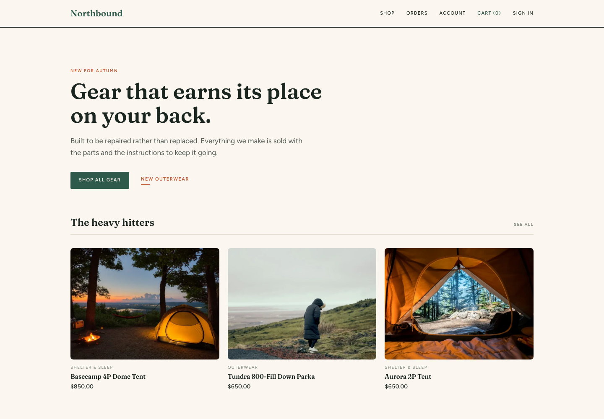

# Northbound

A sample outdoor gear store with a catalog, cart, checkout, order history, and email-and-password sign-in. It shows how [Agent Edge](https://github.com/descope/agent-edge) lets customers' AI agents shop for them with a Descope token, with very few changes to the store.



## Run it

```bash
pnpm install && pnpm db:setup && pnpm dev
```

Open http://localhost:3000. No configuration needed.

| Email | Password |
| --- | --- |
| `alice@example.com` | `alpine-trail-2019` |
| `bob@example.com` | `northbound-legacy-99` |
| `carol@example.com` | `summit-ridge-4410` |

## AI agents

Agent Edge runs in front of the store. It recognizes agents, sends them to the front door for the customer's approval, and blocks payment pages. The store's own sign-in doesn't change. It adds two things:

- **It accepts the agent's token.** [`lib/agentSession/descope.ts`](lib/agentSession/descope.ts) checks the Descope token in the `DS` cookie and signs the agent in as the customer with the same email. The token needs `orders:read` or `orders:write`.
- **It asks before an agent buys.** Agents connect read-only. At checkout, [`lib/agentSession/stepUp.ts`](lib/agentSession/stepUp.ts) sends an agent without `orders:write` to the front door to approve that order.
- **It won't let an agent change the account.** Northbound issues no scope for account data, so [`lib/agentSession/accountChanges.ts`](lib/agentSession/accountChanges.ts) refuses an agent that tries to edit the profile, a saved address, or a payment method. Those are the customer's own, and an agent that needs a different address can ask them. A store that wants to offer this should issue a scope for it and check that here instead.

### The agent API

An agent needs somewhere to spend the access it was given. Northbound publishes one at **`/api/agent/v1`**, described by an OpenAPI document at `/api/agent/v1/openapi.json`, which `/.well-known/poppy.json` advertises in its `apis` list. Without that entry an agent can sign the customer in and then has no URL it is allowed to call — so "where is my parka" fails as a protocol error instead of getting an answer.

| Operation | Needs |
| --- | --- |
| `GET /products` | nothing — browsing is public here, as it is on the website |
| `GET /cart` | `orders:read` |
| `POST /cart/items` | `orders:write` |
| `GET /checkout-options` | `orders:read` — saved addresses and cards, read only |
| `GET /orders`, `GET /orders/{orderNumber}` | `orders:read` |
| `POST /orders` | `orders:write` |

Tokens go in `Authorization: Bearer`, never a cookie, and are checked by the same [`lib/agentSession/descope.ts`](lib/agentSession/descope.ts) the storefront uses. `orders:write` satisfies a read: an assistant allowed to buy with the customer's card is already allowed to see what it bought. The reverse never holds — `orders:read` is published as `changes: "none"`.

A 401 carries `WWW-Authenticate` with `resource_metadata`, pointing at `/.well-known/oauth-protected-resource/api/agent/v1` (RFC 9728), so a client that arrives knowing nothing can find the authorization server from the refusal itself. Agent Edge publishes the matching document for the site at the bare well-known path and forwards this one through to the store.

`POST /orders` buys what is in the cart; there is no `items` parameter, because taking one would mean either silently checking out whatever else the customer already had in their cart or quietly discarding it. Build the cart with `POST /cart/items`, read `total_cents` back, then send it as `expected_total_cents` — the order is refused rather than charged if the total has moved since. Every order records the assistant that placed it.

The storefront did not change to get this. The endpoints call the same [`lib/services`](lib/services) functions the website's own pages call, so there is one set of rules about a customer's orders, and one cart per customer rather than a hidden second one for assistants.

Northbound also shows the customer who has been shopping for them. Every agent that signs in is recorded in `known_agents`, and **/account/assistants** lists each one with what it is allowed to do, when it was approved, when it was last active, and how many orders it placed. Checkout saves the token's `act.sub` with the order, so order history marks those orders "By your AI assistant" and the two lists name the same agent the same way.

Set these in `.env.local`, and run Agent Edge in front of the store (see its [README](https://github.com/descope/agent-edge)):

| Variable | Value |
| --- | --- |
| `DESCOPE_DISCOVERY_URL` | Your Descope inbound app's Discovery URL |
| `DESCOPE_AUDIENCE` | The resource agents' tokens must be for. Set it to the agent API's own identifier, `https://<your site>/api/agent/v1` — that is the `resource` the protected resource metadata publishes, so it is what an agent asks Descope for. Match the front door's `RESOURCE` to it. |
| `DESCOPE_ISSUER` | Optional. The authorization server named in the agent API's protected resource metadata. Unset, it is read from `DESCOPE_DISCOVERY_URL`, which is also where the token verifier gets it — so the two cannot disagree. Use the same value as Agent Edge's `DESCOPE_ISSUER`. |
| `PUBLIC_ORIGIN` | Optional. The origin to use in the discovery documents, such as `https://northbound.camp`. Unset, it follows the host each request arrived on. |
| `FRONT_DOOR_URL` | The front door, for step-up |
| `STEP_UP_SECRET` | The same value as the front door's |
| `AGENT_CLIENTS` | Optional. Names the products behind agent client IDs, as JSON, so `/account/assistants` can show "Muse" instead of an opaque id. Anything unlisted appears as a third-party agent. |
| `DEMO_AUTO_SIGNUP` | `true` creates an account, with a sample address and test card, the first time a new email approves an agent. For demos. |
| `DESCOPE_INTROSPECT_CLIENT_ID` / `_SECRET` | Optional. Set both and the store checks every request against Descope, so revoking an agent takes effect immediately instead of when its token expires. Unset, it verifies the signature offline only — then keep token lifetimes short. |

### How customers approve

That's up to you, in the Descope approval flow. By default they sign in through Descope, with an email code or Google. If you'd rather they approve with their Northbound account, add the External Authentication action to the flow with `https://<your site>/login` as its URL, and set `DESCOPE_PROJECT_ID` and `DESCOPE_MANAGEMENT_KEY`. Northbound then tells Descope who signed in ([`lib/agentSession/externalAuth.ts`](lib/agentSession/externalAuth.ts)).

## Deploy

SQLite on Vercel doesn't keep writes, so set `DATABASE_URL` to a hosted libsql database such as Turso.

## Scripts

| Command | Does |
| --- | --- |
| `pnpm dev` | Development server |
| `pnpm build` | Production build |
| `pnpm test` | Tests |
| `pnpm db:setup` | Migrate and seed. Safe to re-run. |
| `pnpm db:generate` | Regenerate migrations after a schema change |
